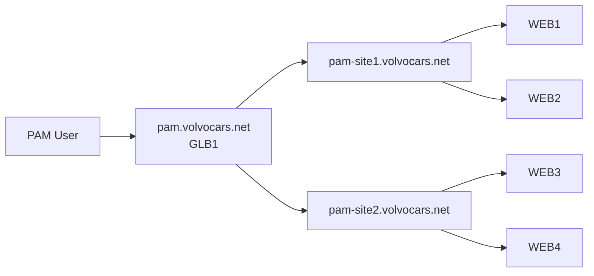
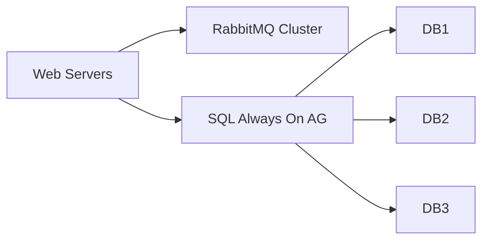
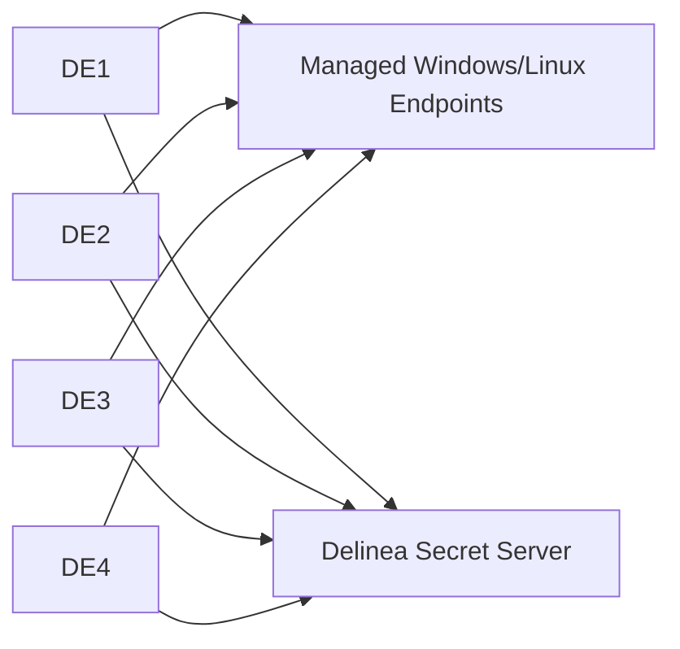
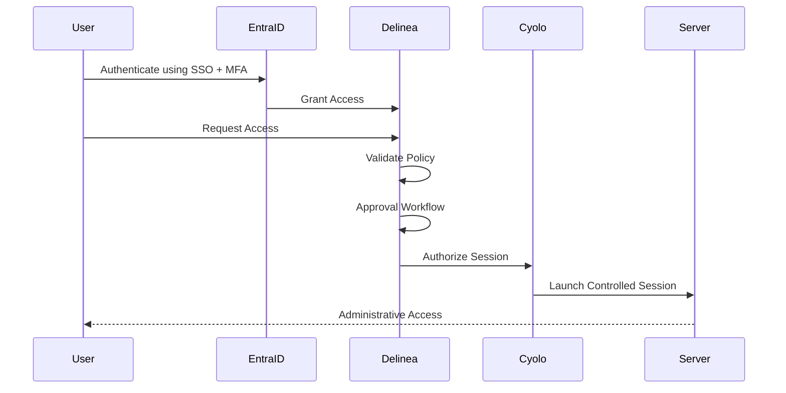

# PAM 2.0 Infrastructure Architecture

## Document Information

| Item | Value |
|--------|--------|
| Solution | PAM 2.0 |
| Platform | Delinea Secret Server |
| Purpose | Architecture, infrastructure topology, responsibilities, and access flows |
| Audience | PAM Architects, Windows Engineers, Identity Engineers, Security Operations, Infrastructure Teams |
| Version | 1.0 |
| Status | Confirmed Infrastructure Topology |

---

# Purpose

This document describes the architecture, infrastructure topology, component responsibilities, high-availability design, and privileged access flows for the PAM 2.0 platform.

The PAM 2.0 platform is built on Delinea Secret Server, utilizing a highly available multi-site deployment across Volvo Cars production and disaster recovery datacenters. The solution integrates Microsoft Entra ID, Active Directory, Cyolo Session Manager, SQL Always On, RabbitMQ clustering, Distributed Engines, and F5 Global/Local Load Balancers.

---

# Architecture Overview

PAM 2.0 uses Delinea Secret Server as the authoritative credential vault while Cyolo Session Manager provides controlled privileged session access.

The solution is deployed across:

- Primary Datacenter (GOT)
- Secondary / DR Datacenter (Cloud)
- Manufacturing DMZ Environment
- F5 Global and Local Load Balancing Layer

The design provides:

- High Availability
- Disaster Recovery
- Secure Secret Management
- Credential Rotation
- Discovery and Onboarding Automation
- Controlled Session Access
- Audit and Compliance Logging

---

# PAM 2.0 Infrastructure Architecture

## Physical Topology

*Figure 1. PAM 2.0 Physical Infrastructure Topology*

---

# Physical Infrastructure Topology

## Primary Datacenter (GOT)

### Database Layer

| Reference | FQDN | IP Address | Service |
|------------|------------|------------|------------|
| DB1 | gotsvw12236.got.volvocars.net | 10.122.84.78 | Database |
| DB2 | gotsvw12238.got.volvocars.net | 10.122.84.100 | Database |
| DB-AOAG | gotsvw12236vc.got.volvocars.net | 10.122.84.98 | SQL Always On Availability Group |
| DB-WSFC | gotsvw12238vc.got.volvocars.net | 10.122.84.101 | Windows Failover Cluster |

### Web Tier

| Reference | FQDN | IP Address |
|------------|------------|------------|
| WEB1 | gotsvw12243.got.volvocars.net | 10.122.84.93 |
| WEB2 | gotsvw12244.got.volvocars.net | 10.122.84.94 |

### Messaging Layer

| Reference | FQDN | IP Address |
|------------|------------|------------|
| MQ1 | gotsvw12303.got.volvocars.net | TBD |
| MQ2 | gotsvw12304.got.volvocars.net | TBD |
| MQ3 | gotsvw12252.got.volvocars.net | 10.122.84.34 |

### Distributed Engine Layer

| Reference | FQDN | IP Address |
|------------|------------|------------|
| DE1 | gotsvw12245.got.volvocars.net | 10.122.84.95 |

---

## Secondary / DR Datacenter (Cloud)

### Database Layer

| Reference | FQDN | IP Address |
|------------|------------|------------|
| DB3 | closvw1985.cloud.volvocars.net | 10.46.158.74 |

### Web Tier

| Reference | FQDN | IP Address |
|------------|------------|------------|
| WEB3 | closvw1979.cloud.volvocars.net | 10.46.158.68 |
| WEB4 | closvw1982.cloud.volvocars.net | 10.46.158.69 |

### RabbitMQ Cluster

| Reference | FQDN | IP Address |
|------------|------------|------------|
| MQ4 | closvw1981.cloud.volvocars.net | 10.46.158.70 |
| MQ5 | closvw1983.cloud.volvocars.net | 10.46.158.72 |
| MQ6 | closvw1984.cloud.volvocars.net | 10.46.158.73 |

### Distributed Engine

| Reference | FQDN | IP Address |
|------------|------------|------------|
| DE2 | closvw1980.cloud.volvocars.net | 10.46.158.71 |

---

## DMZ Discovery Infrastructure

Dedicated Distributed Engines provide secure discovery and password management for manufacturing systems within the vccmfg.net network.

| Reference | FQDN | IP Address |
|------------|------------|------------|
| DE3 | gotsvw12299.vccmfg.net | 10.122.128.87 |
| DE4 | gotsvw12300.vccmfg.net | 10.122.128.88 |

---

## Load Balancing Layer

### Global Load Balancers

| Reference | FQDN | IP Address | Function |
|------------|------------|------------|------------|
| GLB1 | pam.volvocars.net | 10.40.140.159 | Global Traffic Manager |
| GLB2 | pam-mq.volvocars.net | TBD | RabbitMQ Global Traffic Manager |

### Local Load Balancers

| Reference | FQDN | IP Address | Function |
|------------|------------|------------|------------|
| LLB1 | pam-site1.volvocars.net | 10.40.140.157 | Web Traffic to Primary Site |
| LLB2 | pam-site2.volvocars.net | 10.40.140.156 | Web Traffic to DR Site |
| LLB3 | pam-mq-site1.volvocars.net | 10.40.138.69 | RabbitMQ Primary Site |
| LLB4 | pam-mq-site2.volvocars.net | TBD | RabbitMQ DR Site |

---

# Infrastructure Flow

## User Access Flow

---

## Application Processing Flow

---

## Discovery Flow

---

## Breakglass Access Flow

---

# Component Responsibilities

| Component | Responsibility |
|------------|------------|
| Delinea Secret Server | Secret creation, storage, retrieval, rotation, verification, auditing |
| Web Servers | User interface and API services |
| RabbitMQ Cluster | Task orchestration and platform messaging |
| SQL Databases | Platform data storage |
| SQL Always On AG | Database replication and failover |
| WSFC | Cluster management |
| Distributed Engines | Discovery, password management, remote execution |
| Cyolo Session Manager | Controlled session establishment |
| Microsoft Entra ID | Authentication, SSO, MFA |
| Active Directory | Identity governance, groups, GPOs |
| F5 GTM/LTM | Load balancing and failover |
| Managed Endpoints | Windows and Linux target systems |

---

# Responsibility Boundary

| Function | Technology Owner |
|------------|------------|
| Credential Generation | Delinea Secret Server |
| Password Storage | Delinea Secret Server |
| Password Rotation | Delinea Secret Server |
| Password Verification | Delinea Secret Server |
| Secret Retrieval | Delinea Secret Server |
| Discovery | Distributed Engines |
| Session Connectivity | Cyolo Session Manager |
| Authentication | Microsoft Entra ID |
| Multi-Factor Authentication | Microsoft Entra ID |
| Authorization | Delinea and Active Directory |
| Group Management | Active Directory |
| Traffic Routing | F5 Load Balancer |
| Database Availability | SQL Always On and WSFC |

---
# Infrastructure Summary

| Layer | Components |
|---------|---------|
| Global Load Balancing | GLB1, GLB2 |
| Local Load Balancing | LLB1, LLB2, LLB3, LLB4 |
| Web Tier | WEB1, WEB2, WEB3, WEB4 |
| Database Tier | DB1, DB2, DB3 |
| SQL Availability | DB-AOAG, DB-WSFC |
| RabbitMQ Cluster | MQ1, MQ2, MQ3, MQ4, MQ5, MQ6 |
| Distributed Engines | DE1, DE2, DE3, DE4 |

---

# Infrastructure Capacity Summary

| Component Type | Quantity |
|----------------|----------|
| Web Servers | 4 |
| Database Servers | 3 |
| SQL Cluster Services | 2 |
| RabbitMQ Servers | 6 |
| Distributed Engines | 4 |
| Global Load Balancers | 2 |
| Local Load Balancers | 4 |
| Total Managed PAM Infrastructure Nodes | 25 |

---

# High Availability Design

| Layer | Availability Mechanism |
|---------|---------|
| Web Layer | Multiple Web Servers |
| Database Layer | SQL Always On Availability Group |
| Database Cluster | WSFC |
| Messaging Layer | RabbitMQ Cluster |
| Discovery Layer | Multiple Distributed Engines |
| Access Layer | F5 GTM and LTM |
| Site Recovery | Secondary Datacenter |

---

# Source Validation Status

## Confirmed

- Infrastructure hostnames
- Infrastructure roles
- Primary and DR topology
- RabbitMQ clustering model
- SQL Always On architecture
- Distributed Engine placement
- F5 load balancing layer
- Delinea ownership of privileged credentials
- Cyolo responsibility boundary

## Planned

- Entra ID integrated authentication
- Cyolo session orchestration workflows

## To Be Confirmed

- Final Cyolo-Delinea integration configuration
- Approval and breakglass workflow configuration
