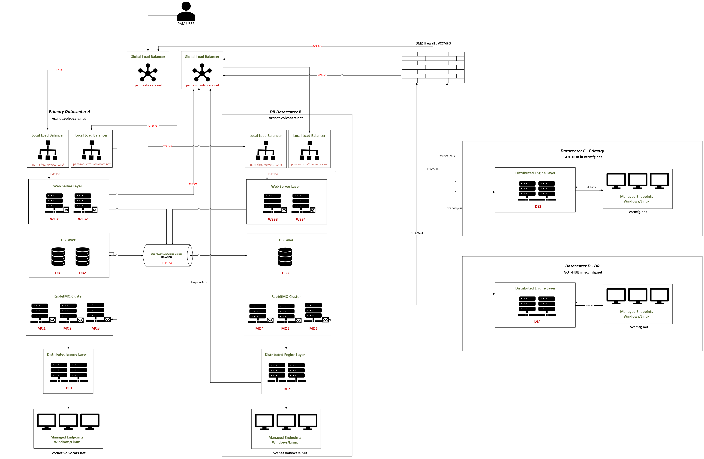

# PAM 2.0 Network Topology

## Purpose

This section defines the network connectivity, firewall requirements, and communication flows required for the PAM 2.0 platform. The requirements cover user access, Delinea Secret Server services, SQL Server Always On availability groups, RabbitMQ messaging, Distributed Engine communications, Active Directory integration, and managed endpoint administration.

---

## Network Communication Matrix

| Source Hostname | Destination Hostname | Source Role | Destination Role | Port / Protocol | Purpose |
|----------------|---------------------|-------------|------------------|----------------|---------|
| End Users | pam.volvocars.net (GLB1) | Users | Global PAM VIP | TCP/443 | Secret Server web access |
| pam.volvocars.net (GLB1) | pam-site1.volvocars.net (LLB1), pam-site2.volvocars.net (LLB2) | Global PAM VIP | Local Load Balancers | TCP/443 | Load balancer traffic |
| pam-site1.volvocars.net (LLB1), pam-site2.volvocars.net (LLB2) | gotsvw12243 (WEB1), gotsvw12244 (WEB2), closvw1979 (WEB3), closvw1982 (WEB4) | Local Load Balancers | Web Servers | TCP/443 | HTTPS application traffic |
| gotsvw12243 (WEB1), gotsvw12244 (WEB2), closvw1979 (WEB3), closvw1982 (WEB4) | gotsvw12236vc (DB-AOAG) | Web Servers | SQL Always On Listener | TCP/1433 | SQL database connectivity |
| gotsvw12236 (DB1), gotsvw12238 (DB2), closvw1985 (DB3) | gotsvw12236 (DB1), gotsvw12238 (DB2), closvw1985 (DB3) | SQL Servers | SQL Servers | TCP/5022 | SQL Always On replication |
| gotsvw12236 (DB1), gotsvw12238 (DB2), closvw1985 (DB3) | gotsvw12236 (DB1), gotsvw12238 (DB2), closvw1985 (DB3) | SQL Servers | SQL Servers | TCP/1433 | SQL inter-node communication |
| gotsvw12243 (WEB1), gotsvw12244 (WEB2), closvw1979 (WEB3), closvw1982 (WEB4) | pam-mq.volvocars.net (GLB2) | Web Servers | RabbitMQ VIP | TCP/5671 | RabbitMQ AMQP over TLS |
| pam-mq.volvocars.net (GLB2) | pam-mq-site1.volvocars.net (LLB3), pam-mq-site2.volvocars.net (LLB4) | RabbitMQ VIP | RabbitMQ Local Load Balancers | TCP/5671 | RabbitMQ load balancing |
| pam-mq-site1 (LLB3), pam-mq-site2 (LLB4) | MQ1, MQ2, MQ3, MQ4, MQ5, MQ6 | RabbitMQ Local Load Balancers | RabbitMQ Cluster | TCP/5671 | RabbitMQ messaging |
| DE1, DE2, DE3, DE4 | pam-mq.volvocars.net (GLB2) | Distributed Engines | RabbitMQ VIP | TCP/5671 | RabbitMQ messaging |
| MQ1, MQ2, MQ3, MQ4, MQ5, MQ6 | MQ1, MQ2, MQ3, MQ4, MQ5, MQ6 | RabbitMQ Nodes | RabbitMQ Nodes | TCP/4369 | Erlang Port Mapper (EPMD) |
| MQ1, MQ2, MQ3, MQ4, MQ5, MQ6 | MQ1, MQ2, MQ3, MQ4, MQ5, MQ6 | RabbitMQ Nodes | RabbitMQ Nodes | TCP/25672 | RabbitMQ cluster communication |
| Admin Workstations | MQ1, MQ2, MQ3, MQ4, MQ5, MQ6 | Administration | RabbitMQ Nodes | TCP/15671 | RabbitMQ management access |
| DE1, DE2, DE3, DE4 | WEB1, WEB2, WEB3, WEB4 | Distributed Engines | Web Servers | TCP/443 | Distributed Engine communication |
| WEB1, WEB2, WEB3, WEB4 | Domain Controllers | Web Servers | Active Directory Services | TCP/UDP 53 | DNS resolution |
| WEB1, WEB2, WEB3, WEB4 | Domain Controllers | Web Servers | Active Directory Services | TCP/UDP 88 | Kerberos authentication |
| WEB1, WEB2, WEB3, WEB4 | Domain Controllers | Web Servers | Active Directory Services | TCP/389 | LDAP |
| WEB1, WEB2, WEB3, WEB4 | Domain Controllers | Web Servers | Active Directory Services | TCP/636 | LDAPS |
| WEB1, WEB2, WEB3, WEB4 | Domain Controllers | Web Servers | Global Catalog | TCP/3268 | Global Catalog access |
| WEB1, WEB2, WEB3, WEB4 | Domain Controllers | Web Servers | Secure Global Catalog | TCP/3269 | Secure Global Catalog access |
| WEB1, WEB2, WEB3, WEB4 | SMTP Relay | Web Servers | Mail Services | TCP/465 | Email notifications and alerts |
| DE1, DE2, DE3, DE4 | Windows Managed Servers | Distributed Engines | Windows Managed Servers | TCP/3389 | Native RDP connectivity |
| DE1, DE2, DE3, DE4 | Windows Managed Servers | Distributed Engines | Windows Managed Servers | TCP/135 | RPC Endpoint Mapper |
| DE1, DE2, DE3, DE4 | Windows Managed Servers | Distributed Engines | Windows Managed Servers | TCP/445 | SMB communication |
| DE1, DE2, DE3, DE4 | Windows Managed Servers | Distributed Engines | Windows Managed Servers | TCP/49152-65535 | Dynamic RPC ports for password management and discovery |
| DE1, DE2, DE3, DE4 | Linux/Unix Managed Servers | Distributed Engines | Linux/Unix Managed Servers | TCP/22 | SSH connectivity |
| gotsvw12299 (DE3), gotsvw12300 (DE4) | pam-mq.volvocars.net (GLB2) | DMZ Distributed Engines | RabbitMQ VIP | TCP/5671 | RabbitMQ communication |
| gotsvw12299 (DE3), gotsvw12300 (DE4) | WEB1, WEB2, WEB3, WEB4 | DMZ Distributed Engines | Web Servers | TCP/443 | Distributed Engine communication |
| gotsvw12299 (DE3), gotsvw12300 (DE4) | Windows Managed Servers | DMZ Distributed Engines | Windows Managed Servers | TCP/3389 | RDP connectivity |
| gotsvw12299 (DE3), gotsvw12300 (DE4) | Windows Managed Servers | DMZ Distributed Engines | Windows Managed Servers | TCP/5986 | WinRM over HTTPS |
| gotsvw12299 (DE3), gotsvw12300 (DE4) | Linux/Unix Managed Servers | DMZ Distributed Engines | Linux/Unix Managed Servers | TCP/22 | SSH connectivity |




*Figure 1. PAM 2.0 Topology*

---

## Network Flow Overview

### User Access Flow

```text
End Users
    │ TCP/443
    ▼
GLB1 (pam.volvocars.net)
    │ TCP/443
    ▼
LLB1 / LLB2
    │ TCP/443
    ▼
WEB1 / WEB2 / WEB3 / WEB4
```

### Database Communication Flow

```text
WEB Servers
    │ TCP/1433
    ▼
DB-AOAG Listener
    │
    ▼
DB1 ↔ DB2 ↔ DB3

SQL Always On Replication:
TCP/5022
```

### RabbitMQ Messaging Flow

```text
WEB Servers
Distributed Engines
       │
       │ TCP/5671
       ▼
   GLB2 (pam-mq)
       │
       ▼
   LLB3 / LLB4
       │
       ▼
MQ1 ↔ MQ2 ↔ MQ3 ↔ MQ4 ↔ MQ5 ↔ MQ6

Cluster Communication:
TCP/4369
TCP/25672
```

### Distributed Engine Management Flow

```text
DE1 / DE2 / DE3 / DE4
       │
       ├─ TCP/443 ──────────► Secret Server Web Tier
       │
       ├─ TCP/5671 ─────────► RabbitMQ Cluster
       │
       ├─ TCP/3389 ─────────► Windows Servers (RDP)
       │
       ├─ TCP/135,445 ──────► RPC / SMB
       │
       ├─ TCP/49152-65535 ─► Dynamic RPC Ports
       │
       └─ TCP/22 ───────────► Linux/Unix Servers
```

### DMZ Discovery Flow

```text
DE3 / DE4 (DMZ)
       │
       ├─ TCP/443  ─► WEB Tier
       ├─ TCP/5671 ─► RabbitMQ VIP
       ├─ TCP/3389 ─► Windows Managed Servers
       ├─ TCP/5986 ─► WinRM HTTPS
       └─ TCP/22   ─► Linux/Unix Managed Servers
```

---

## Firewall Requirements

### User Access

- Allow TCP/443 from approved user networks to `pam.volvocars.net`.
- Restrict all direct access to WEB servers from user networks.

### Database Services

- Allow TCP/1433 from WEB servers to DB-AOAG listener.
- Allow TCP/5022 between SQL cluster nodes for Always On replication.
- Restrict SQL communications to PAM infrastructure only.

### RabbitMQ Services

- Allow TCP/5671 between:
  - WEB servers and RabbitMQ VIP
  - Distributed Engines and RabbitMQ VIP
  - RabbitMQ load balancers and RabbitMQ cluster nodes

- Allow TCP/4369 and TCP/25672 between RabbitMQ cluster members only.
- Do not expose RabbitMQ cluster ports externally.

### Active Directory Integration

Allow communication from WEB servers to Domain Controllers for:

| Port | Service |
|--------|---------|
| TCP/UDP 53 | DNS |
| TCP/UDP 88 | Kerberos |
| TCP 389 | LDAP |
| TCP 636 | LDAPS |
| TCP 3268 | Global Catalog |
| TCP 3269 | Secure Global Catalog |

### Managed Endpoint Connectivity

#### Windows Endpoints

| Port | Purpose |
|--------|---------|
| TCP/3389 | RDP |
| TCP/135 | RPC Endpoint Mapper |
| TCP/445 | SMB |
| TCP/49152-65535 | Dynamic RPC |

#### Linux/Unix Endpoints

| Port | Purpose |
|--------|---------|
| TCP/22 | SSH |

### DMZ Requirements

- Permit TCP/443 from DE3 and DE4 to the WEB tier.
- Permit TCP/5671 from DE3 and DE4 to the RabbitMQ VIP.
- Do not allow DMZ Distributed Engines direct SQL access.
- Restrict DMZ traffic to approved PAM service ports only.

---

## Security Considerations

> Only TCP/443 should be exposed to end users through the F5 load-balancing layer.

> RabbitMQ cluster ports (4369 and 25672) must remain internal to platform components.

> SQL Always On replication traffic (TCP/5022) must remain restricted to database servers.

> Dynamic RPC ports (TCP/49152-65535) are required for Windows account management and password rotation operations.

> Distributed Engines deployed in the DMZ must communicate only with approved PAM platform services and managed endpoints.
