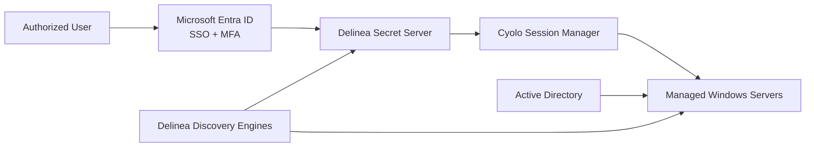
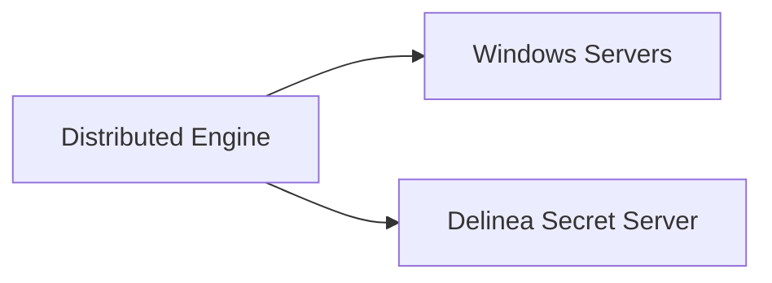
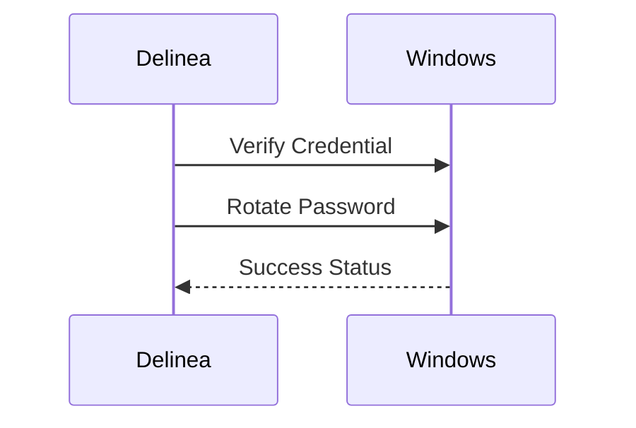
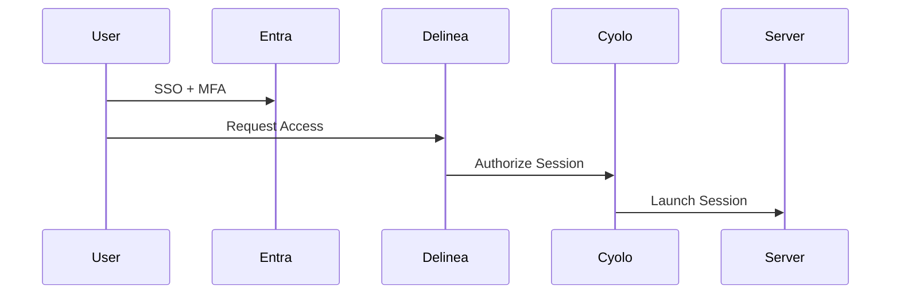

# PAM 2.0 Windows Privileged Access Logical Architecture

## Purpose

This document describes how privileged access to Windows systems is governed through Delinea Secret Server, Microsoft Entra ID, Active Directory, Cyolo Session Manager, and Distributed Engines.

## Logical Overview

## Logical flows

### Discovery

Delinea Discovery Engines scan approved Windows servers using the permitted network path and approved scanning identity. Discovered Windows servers and accounts are reviewed before onboarding.

### Credential management

Delinea stores and governs the credential for `volvop27`. Only Delinea generates, rotates, verifies, and retains password history for the account.

### User access

An authorized user authenticates through Entra ID SSO and MFA, supplies the required justification and ticket reference, obtains access under the applicable approval model, and launches a controlled Cyolo session to an authorized target.

## Component Responsibilities

| Component | Responsibility |
|------------|------------|
| Delinea Secret Server | Credential storage, retrieval, rotation, audit |
| Discovery Engines | Windows discovery and management |
| Microsoft Entra ID | Authentication and MFA |
| Active Directory | Authorization and policy |
| Cyolo Session Manager | Session brokering |
| Windows Servers | Managed endpoints |

## Discovery Flow

## Credential Management Flow

## User Access Flow

## Responsibility Boundary

| Function | Owner |
|------------|------------|
| Password Generation | Delinea |
| Password Rotation | Delinea |
| Credential Storage | Delinea |
| User Authentication | Entra ID |
| Authorization | Delinea + AD |
| Session Connectivity | Cyolo |
| Discovery | Distributed Engines |

## Security Constraints

- Delinea and Microsoft LAPS must not manage the same account simultaneously.
- Password rotation must only be enabled after LAPS ownership has been removed.
- Historical password access must be audited.
- Credentials must never be stored in emails, tickets, chats, or documentation.
