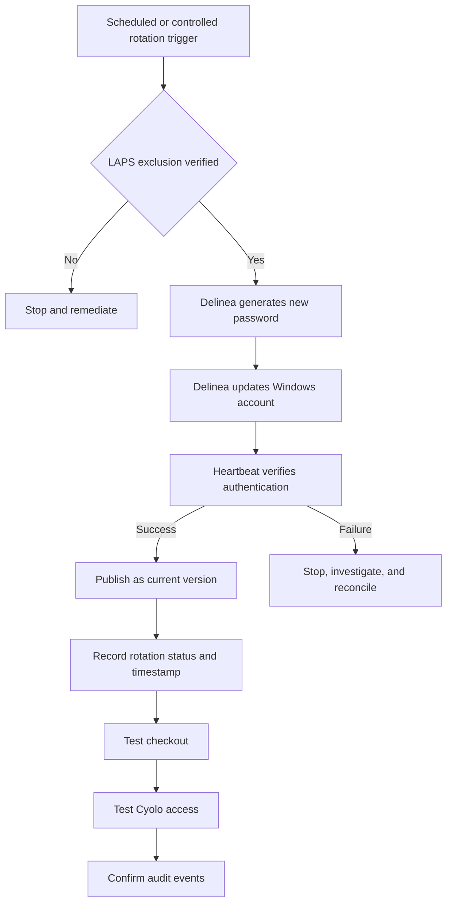

# Password Management

**Purpose:** Define Delinea ownership and the rotation, verification, history, and checkout controls for `volvop27`.  
**Audience:** Delinea administrators, PAM operators, Windows engineers, and security auditors.

## Ownership and authority

Delinea Secret Server is the sole password authority for `volvop27`. It owns:

- Password generation and storage.
- Rotation.
- Authentication verification.
- Password history.
- Governed retrieval.
- Access policy and audit events.

Cyolo does not own or rotate the password.

LAPS must be excluded before Delinea rotation is enabled.

> [!WARNING]
> Do not enable rotation until effective LAPS exclusion has been verified on the target server.

## Password rotation flow

> [!IMPORTANT]
> Rotation must occur through Delinea. No administrator or end user may manually reset the credential outside the approved reconciliation and recovery process.

## Verification procedure

1. Confirm that effective LAPS exclusion is still present.
2. Confirm the target account exists and is enabled.
3. Use the approved Delinea heartbeat or password changer.
4. Confirm that authentication succeeds against the Windows target.
5. Verify the new credential state in Delinea.
6. Test one controlled governed checkout using an approved test identity.
7. Test a Cyolo session to the target.
8. Confirm the audit event sequence.

## Password history

Delinea maintains password history for the managed account. Historical versions are used only for controlled recovery and reconciliation.

Historical-password access is:

- Restricted to authorized PAM recovery roles.
- Audited.
- Permitted only with a valid incident or change reference.

Passwords must never be copied into tickets, email, Teams, files, or notes.

## Runbook: Controlled password rotation

### Purpose

Create a new managed credential while preserving account availability and audit evidence.

### Trigger

- Scheduled rotation.
- Security policy or incident trigger.
- Approved recovery or credential reconciliation.

### Required role

- Delinea Secret Server administrator.
- Authorized Windows engineer where target validation is required.
- Change approver, when the change policy requires approval.

### Preconditions

- LAPS exclusion is verified.
- Target account is enabled and reachable.
- Heartbeat and password changer are configured.
- No conflicting LAPS or manual reset is active.
- Change record is valid.

### Procedure

1. Confirm the target and account identity.
2. Validate the change record and maintenance window.
3. Confirm effective LAPS exclusion.
4. Inspect the password changer and heartbeat status before rotation.
5. Trigger rotation in Delinea.
6. Record rotation status and timestamps, never password values.
7. Confirm heartbeat success.
8. Verify the current credential state through the approved test method.
9. Test governed checkout and Cyolo access.
10. Confirm audit events and close the change record.

### Validation

- A single active credential owner exists.
- The Windows account validates against Delinea.
- The heartbeat succeeds.
- Checkout and Cyolo access succeed.
- Audit events are complete.

### Evidence

- Rotation request and timestamps.
- LAPS exclusion evidence.
- Password changer and heartbeat status.
- Verification result.
- Checkout and session test result.
- Audit event references.

### Rollback

1. Stop additional rotation attempts if verification fails.
2. Preserve the last known verified state.
3. Reconcile Delinea and the Windows account through an authorized recovery process.
4. Do not restore LAPS as a simultaneous owner.
5. Escalate unresolved credential mismatch.

### Stop conditions

- LAPS exclusion cannot be verified.
- Delinea and LAPS might manage the account simultaneously.
- Target account is disabled or locked.
- Heartbeat or verification fails.
- Reconciliation cannot identify the active credential state.

### Escalation

Escalate to the PAM platform team, Windows infrastructure team, and incident or change manager as applicable.

