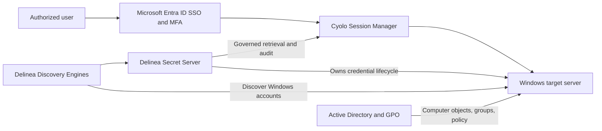

# PAM 2.0 Logical Architecture

**Purpose:** Explain component responsibilities and the logical breakglass access path.  
**Audience:** PAM architects, Windows engineers, identity engineers, and security operations.

## Architecture overview

PAM 2.0 uses Delinea Secret Server as the sole credential authority for `volvop27`, while Cyolo Session Manager provides the controlled connection tier. Active Directory and Group Policy enable approved discovery and connection access on target servers.

## Component responsibilities

| Component | Confirmed responsibility |
|---|---|
| Delinea Secret Server | Credential generation, storage, governed retrieval, rotation, verification, history, access policy, and audit |
| Delinea Discovery Engine | Windows server and local-account discovery |
| Microsoft Entra ID | SSO and MFA for access governance |
| Active Directory | Computer objects, groups, GPOs, and policy targeting |
| Cyolo Session Manager | Controlled Windows session launch and target connectivity; no password ownership or rotation |
| Windows Server | Target host containing the managed local account |

## Logical flows

### Discovery

Delinea Discovery Engines scan approved Windows servers using the permitted network path and approved scanning identity. Discovered Windows servers and accounts are reviewed before onboarding.

### Credential management

Delinea stores and governs the credential for `volvop27`. Only Delinea generates, rotates, verifies, and retains password history for the account.

### User access

An authorized user authenticates through Entra ID SSO and MFA, supplies the required justification and ticket reference, obtains access under the applicable approval model, and launches a controlled Cyolo session to an authorized target.

## Responsibility boundary

| Function | Owner |
|---|---|
| Credential generation and storage | Delinea Secret Server |
| Password verification and history | Delinea Secret Server |
| Rotation authority | Delinea Secret Server |
| Target session connectivity | Cyolo Session Manager |
| User identity and MFA | Microsoft Entra ID |
| Discovery | Delinea Discovery Engines |
| Server and policy targeting | Active Directory |

## Security constraints

- Do not configure LAPS and Delinea as simultaneous managers.
- Do not enable Delinea rotation before confirming LAPS exclusion.
- Do not permit unrestricted remote administration or remote SAM access.
- Do not expose the password in logs, tickets, email, chat, or notes.
- Historical password access must be restricted and audited.

> [!WARNING]
> Rotation is prohibited until the target server is confirmed to exclude `volvop27` from LAPS management.

## Prerequisites

- Confirmed server ownership and onboarding approval.
- Network connectivity from an approved Discovery Engine.
- Approved AD placement and GPO targeting.
- Valid Entra ID, Delinea, and Cyolo administration roles.

## Open integration details

> [!IMPORTANT]
> TBC: Exact Cyolo integration method, Delinea URL and folder, secret template, and the user eligibility and approval model.
> Owner: PAM platform and IAM teams

> [!IMPORTANT]
> TBC: The complete production and non-production component topology has not been supplied.
> Owner: PAM architecture team

## Source and validation status

**Confirmed:** Component responsibilities, account ownership, LAPS replacement, and Cyolo boundary are explicitly defined.  
**Planned:** User access through Entra ID, Delinea, and Cyolo.  
**TBC:** Integration configuration and topology details.
