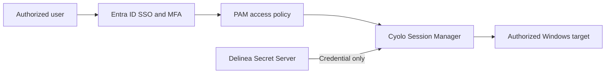

# Cyolo Integration

**Purpose:** Define the Cyolo Session Manager connection tier and administrative controls.  
**Audience:** Cyolo administrators, PAM administrators, network engineers, and security operations.

## Responsibility boundary

Cyolo provides controlled target connectivity and session launch. Cyolo does not generate, store, rotate, or own the managed Windows password.

Delinea remains the sole credential authority for `volvop27`.

## Integration model

The approved logical flow is:

1. User signs in using Microsoft Entra ID SSO.
2. MFA is completed.
3. User provides a justification and ticket reference.
4. The access policy grants an immediate or approved session.
5. Cyolo launches a controlled Windows session to an authorized target.
6. Session activity is subject to the approved security and audit controls.

> [!IMPORTANT]
> TBC: Exact Cyolo integration method, target discovery mapping, SSO configuration, protocol mapping, and session recording requirements.
> Owner: Cyolo and PAM platform teams

## Integration flow

Do not draw an unconfirmed direct integration that is not established in the approved architecture. The diagram represents the logical credential and session boundary only.

## Administrative prerequisites

- Target server is discoverable and onboarded.
- Server belongs to an approved production or non-production scope.
- User eligibility and approval policy are configured.
- MFA and Entra ID identity validation are operational.
- Cyolo target mapping is controlled and approved.
- Network routes permit the intended authorized session path.

> [!IMPORTANT]
> TBC: Approval and eligibility groups, checkout duration, target mapping method, and Cyolo protocol configuration.
> Owner: IAM and PAM teams

## Validation procedure

1. Create an approved test user or use an approved test identity.
2. Confirm the user can complete Entra ID SSO and MFA.
3. Confirm the target appears only when authorized.
4. Complete an immediate or approval-based test according to policy.
5. Launch a Cyolo session to an approved test server.
6. Confirm session launch uses the governed credential path.
7. Perform a limited read-only validation task.
8. Close the session.
9. Confirm checkout, session, and audit events.

## Session responsibilities

- Users perform only approved tasks.
- Users must not export or record credentials.
- Administrators must not disclose credential values through Cyolo or support channels.
- Session access must remain within the approved ticket and time window.

## Troubleshooting boundaries

Before changing Cyolo configuration:

1. Exclude SSO and MFA failures.
2. Exclude incorrect target selection or authorization scope.
3. Exclude network and firewall restrictions.
4. Exclude account lockout or account disablement.
5. Confirm the Delinea credential separately.

Do not disable MFA or bypass approval controls to restore access.

## Rollback

1. Disable or remove only the temporary Cyolo target or policy change.
2. Restore the prior approved target mapping or access policy.
3. Revalidate SSO, MFA, and authorization.
4. Test through a controlled session.
5. Preserve the change and rollback evidence.

## Source and validation status

**Confirmed:** Cyolo is the controlled session launch tier and does not own or rotate the password.  
**TBC:** Exact integration mechanism, target mapping, protocol, recording, eligibility groups, and session duration.
