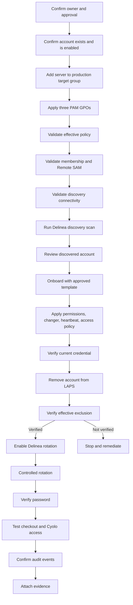

# Discovery and Onboarding

**Purpose:** Provide the controlled sequence for discovering and onboarding the Windows breakglass account.  
**Audience:** Delinea administrators, Discovery Engine administrators, Windows engineers, and PAM operations.

## Runbook: Onboard a breakglass target

### Purpose

Add an approved Windows server and `volvop27` to governed Delinea management without introducing simultaneous LAPS and Delinea ownership.

### Trigger

- New server requires breakglass onboarding.
- Approved server replacement or environment migration.
- Change record requires managed breakglass account validation.

### Required role

- Delinea Secret Server administrator.
- Windows infrastructure administrator.
- AD/GPO administrator.
- Change approver.
- Discovery Engine administrator, if connectivity or scan configuration is involved.

### Preconditions

- Server owner and onboarding approval are available.
- The server is an approved VCCNET or VCCMFG target.
- The account `volvop27` exists and is enabled.
- Approved AD and GPO implementation is available.
- An assigned Discovery Engine has approved network connectivity.
- LAPS exclusion design has been reviewed.

## Procedure

1. **Confirm server owner and approval.**  
   Record the server owner, target environment, change reference, and onboarding approver.

2. **Confirm account state.**  
   Validate that `volvop27` exists and is enabled. Record only evidence status, not password values.

3. **Add the target server to `Server-PAM-Prod`.**  
   Confirm the server computer object is approved and belongs in the target OU.

4. **Apply the three PAM GPOs.**  
   Apply ScannerAccess, RemoteSAM, and RPCFirewall according to the approved change scope.

5. **Validate effective Group Policy.**  
   Confirm GPO precedence, security filtering, effective rights, and firewall rules.

6. **Validate local membership and Remote SAM.**  
   Confirm the approved scanning identity has the required effective local and Remote SAM permissions.

7. **Validate Discovery Engine connectivity.**  
   Test only the approved source IP and required network paths.

8. **Run the Delinea discovery scan.**  
   Use the assigned and approved Discovery Engine. Confirm discovery status and expected server count.

9. **Review discovered accounts.**  
   Verify that `volvop27` is identified on the correct server and no duplicate or unrelated account was selected.

10. **Onboard using the approved Delinea template.**  
    Use the confirmed folder and secret template.

    > [!IMPORTANT]
    > TBC: Delinea URL, folder, secret template, and account onboarding template.
    > Owner: PAM platform team

11. **Apply permissions, password changer, and heartbeat.**  
    Apply the approved access policy and validate the account-management configuration.

    > [!IMPORTANT]
    > TBC: Password changer, heartbeat frequency, access policy, and checkout duration.
    > Owner: PAM platform team

12. **Verify the current credential.**  
    Use an approved method to confirm Delinea can authenticate and that heartbeat is operational.

13. **Remove `volvop27` from LAPS management.**  
    Use the validated exclusion method and do not partially or inconsistently configure the server.

14. **Confirm effective LAPS exclusion.**  
    Verify locally and through available approved policy evidence. Do not rely only on GPO intent.

> [!WARNING]
> Do not enable Delinea password rotation until LAPS exclusion has been verified on the target server.

15. **Enable Delinea rotation.**  
    Only after the previous warning is satisfied and the change approver confirms readiness.

16. **Perform a controlled rotation.**  
    Record status and timestamps. Do not record or copy password values.

17. **Verify the new password.**  
    Confirm the heartbeat and a controlled authentication test are successful.

18. **Test authorized checkout and Cyolo access.**  
    Use an approved test identity and target session. Confirm the user receives the correct authorization and session behavior.

19. **Confirm audit events.**  
    Verify discovery, onboarding, rotation, checkout, and session events are represented in the approved audit locations.

20. **Attach evidence to the change record.**  
    Include timestamps and evidence references while excluding credential values.

## Discovery workflow diagram

## Validation

- The server appears in the approved Delinea scope.
- The account is onboarded once and correctly identified.
- Heartbeat and password verification succeed.
- LAPS exclusion is effective.
- Rotation succeeds once and only after exclusion.
- Checkout and Cyolo session work for an approved test identity.
- Relevant audit events are available.

## Evidence

- Onboarding approval and server owner.
- Change record and timestamps.
- GPO and effective-policy evidence.
- Discovery scan and account review.
- LAPS exclusion evidence.
- Rotation and heartbeat status.
- Cyolo test-session evidence.
- Audit event references.

## Rollback

1. Disable Delinea rotation if the change must be reversed.
2. Retain the last verified credential state and do not expose its value.
3. Restore any prior approved LAPS state only if it is confirmed safe and the owner approves.
4. Remove or defer the Delinea onboarding where necessary.
5. Restore GPO scope and network access in reverse change order.
6. Record all restored states and validate service continuity.

## Stop conditions

- Server ownership or onboarding approval is missing.
- `volvop27` is not confirmed present or enabled.
- LAPS exclusion cannot be proven.
- Discovery connectivity is not restricted and approved.
- Existing management conflicts are unresolved.
- Credential verification or rotation fails.

## Source and validation status

**Confirmed:** Required onboarding sequence and rotation safety gate.  
**TBC:** Template, URL, folder, heartbeat, checkout duration, test identities, discovery schedule, and engine assignment.
