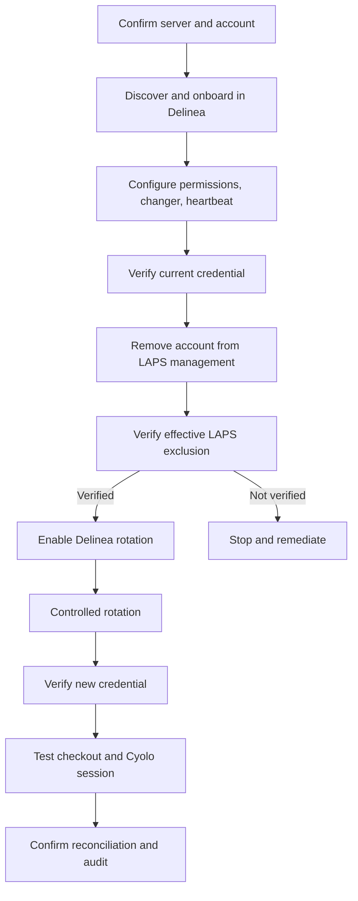

# LAPS to Delinea Transition

**Purpose:** Define the controlled transition from LAPS to Delinea as sole credential owner for `volvop27`.  
**Audience:** Windows infrastructure engineers, AD/GPO administrators, and PAM administrators.

## Ownership principle

Delinea Secret Server becomes the sole owner of password generation, storage, rotation, verification, history, and governed retrieval for `volvop27`.

LAPS and Delinea must not manage `volvop27` simultaneously.

## Transition prerequisites

- Approved onboarding and server owner.
- Confirmed account existence and enabled state.
- Required PAM GPOs and network access available.
- Delinea onboarding completed and heartbeat verified.
- Approved LAPS exclusion method identified and change approved.
- A valid credential reconciliation plan.
- Rollback plan and change window.

> [!IMPORTANT]
> TBC: Exact LAPS exclusion method and reconciliation process.
> Owner: Windows infrastructure and AD teams

## Transition flow

## Procedure

1. **Record the starting state.**  
   Capture the server identity, timestamp, LAPS configuration state, and evidence that `volvop27` is managed by LAPS. Do not record password values.

2. **Onboard `volvop27` in Delinea.**  
   Complete discovery review and apply permissions, password changer, heartbeat, and access policy.

3. **Verify the current credential.**  
   Confirm Delinea can authenticate to the account before changing ownership.

4. **Apply the approved LAPS exclusion.**  
   Use the exact, validated exclusion method confirmed by the Windows team.

5. **Verify effective exclusion.**  
   Check local effective configuration and policy evidence after policy refresh. Confirm no LAPS process or policy can rotate or update `volvop27`.

> [!WARNING]
> Do not enable Delinea password rotation until effective LAPS exclusion is verified on the target server.

6. **Enable Delinea rotation.**  
   Set the approved password, rotation, verification, and heartbeat policy once the exclusion is confirmed.

7. **Perform a controlled rotation.**  
   Execute a change-approved rotation and record the status and timestamp only.

8. **Verify the new credential.**  
   Confirm authentication, heartbeat, checkout, and Cyolo session access work with the new credential.

9. **Confirm reconciliation.**  
   Verify Delinea and the Windows account represent the same active credential state.

10. **Preserve evidence.**  
    Attach policy, LAPS exclusion, rotation, verification, and audit evidence to the change record.

## Validation

- Delinea heartbeat succeeds.
- The Windows account is still enabled.
- LAPS cannot update or rotate `volvop27`.
- Delinea is the only active rotation authority.
- A controlled rotation succeeds.
- The new credential verifies successfully.
- Authorized checkout and Cyolo access succeed.
- Audit events are available.

## Rollback

1. Stop and do not retry rotation if exclusion is not proven.
2. Re-enable the prior approved LAPS state only if the change approval permits it and another credential owner is not active.
3. Do not restore LAPS while Delinea is actively rotating `volvop27`.
4. Disable or defer Delinea rotation if ownership cannot be reconciled safely.
5. Restore previous GPO or policy state only through the approved rollback sequence.
6. Record all evidence and escalate unresolved ownership conflicts.

## Stop conditions

- LAPS exclusion evidence is unavailable or ambiguous.
- Any policy indicates LAPS can still manage the account.
- Delinea and LAPS might both remain active.
- Credential verification fails before rotation.
- The account is locked, disabled, or inaccessible.
- Rotation verification is unsuccessful.

## Source and validation status

**Confirmed:** Delinea sole ownership, no simultaneous management, required exclusion verification, and rotation gate.  
**TBC:** Exact exclusion mechanism, reconciliation method, password policy, heartbeat, and rotation schedule.
