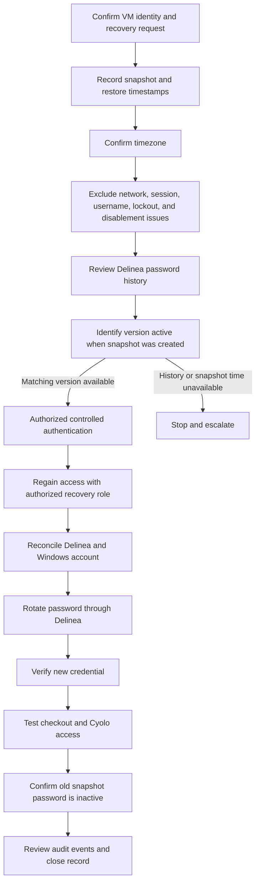

# VM Snapshot Recovery

**Purpose:** Reconcile a Windows VM restored from an older snapshot with the current Delinea credential.  
**Audience:** PAM recovery administrators, Windows engineers, change managers, and security operations.

## Trigger

Use this runbook when a VM is restored from a snapshot and Windows may contain a historical password that does not match the current Delinea credential.

## Required role

- Authorized PAM recovery administrator.
- Windows infrastructure engineer.
- Change manager or incident commander.
- Approver authorized for the snapshot-recovery model.

## Preconditions

- VM identity is confirmed.
- Valid incident or change is mandatory.
- Snapshot creation and restoration timestamps are known.
- Timezone is confirmed.
- A valid password-history access role is available.
- Standard network, Cyolo, username, lockout, disablement, and connectivity issues are excluded or documented.

## Security rules

- Historical-password access is restricted and audited.
- Do not copy passwords into tickets, email, Teams, files, or notes.
- Standard end users must not access password history.
- Do not assume the immediately previous password is correct.
- Use the minimum number of controlled authentication attempts.
- Record password version and timestamp, never the password value.
- Do not disable security controls or perform undocumented password resets.
- Stop and escalate if snapshot time, matching password version, or history is unavailable.

## Recovery flow

## Procedure

1. **Confirm VM identity and approved recovery request.**  
   Record the VM, incident or change reference, requester, recovery approver, and target environment.

2. **Record snapshot timestamps.**  
   Record snapshot creation and VM restoration timestamps from the approved infrastructure evidence.

3. **Confirm timezone.**  
   Normalize all timestamps to an explicitly recorded timezone. Confirm that Delinea and infrastructure timestamps use the same interpretation.

4. **Exclude unrelated issues.**  
   Validate network connectivity, Cyolo routing, username format, account lockout, account disablement, DNS, firewall, and target identity.

5. **Review Delinea password history.**  
   Use only the authorized recovery role and audit-enabled process.

6. **Identify the active password version.**  
   Determine which password version was active on the VM at snapshot creation. Use version and timestamp evidence rather than assuming the immediately previous version.

7. **Do not assume.**  
   Stop if the snapshot time is uncertain or if multiple password versions overlap the recovery interval.

8. **Use controlled authentication attempts.**  
   Use the minimum number of authorized attempts permitted by the lockout policy. Record attempt status and timestamps, not password values.

9. **Regain access.**  
   Use the authorized recovery role and approved method only. Do not disable lockout, account controls, or security settings.

10. **Reconcile Delinea and Windows.**  
    Confirm the current Windows account state and reconcile it to the governed Delinea credential state using the approved method.

11. **Rotate through Delinea.**  
    Trigger a controlled rotation only after reconciliation and authorized access. Do not manually reset the password outside the approved workflow.

12. **Verify the new credential.**  
    Confirm heartbeat and controlled authentication succeed.

13. **Test governed checkout and Cyolo access.**  
    Use an approved test identity and target session.

14. **Confirm historical password inactivity.**  
    Verify that the snapshot password is no longer active for normal authentication and remains governed by history controls.

15. **Review audit events.**  
    Confirm approval, history access, reconciliation, rotation, verification, checkout, and Cyolo events.

16. **Close the recovery record.**  
    Attach evidence and record the final credential-state status without credential values.

## Validation

- VM identity and snapshot times are confirmed.
- Correct password version was identified using evidence.
- Account access was regained only through authorized controls.
- Delinea and Windows credential states match.
- Rotation and heartbeat succeeded.
- Checkout and Cyolo access succeeded.
- Historical password is no longer active.
- Audit events are complete.

## Evidence

- Incident or change reference.
- VM identity and environment.
- Snapshot creation and restoration timestamps.
- Timezone evidence.
- Password-version reference and timestamp, without value.
- Authentication attempt count and outcome.
- Reconciliation method and timestamp.
- Rotation and verification status.
- Checkout and Cyolo test result.
- Audit event references.

## Rollback

1. Stop repeated authentication attempts if lockout or mismatch occurs.
2. Restore prior VM or network state only through the approved infrastructure process.
3. Do not rotate or reset the account outside Delinea if reconciliation is uncertain.
4. Preserve the snapshot evidence and audit trail.
5. Escalate unresolved identity or credential mismatch.

## Stop conditions

- VM identity is uncertain.
- Snapshot creation or restoration time is unavailable or conflicting.
- Timezone cannot be confirmed.
- Password history is unavailable or unauthorized.
- The matching password version cannot be identified.
- Historical-password access lacks a valid incident or change.
- Account lockout or disablement is unresolved.
- Reconciliation or rotation cannot be completed safely.

## Escalation

Escalate to:

- PAM recovery and platform team.
- Windows infrastructure team.
- Security operations.
- Incident or change manager.

> [!IMPORTANT]
> TBC: Snapshot-recovery approval model, reconciliation method, lockout threshold, history retention, and authorized recovery roles.
> Owner: PAM governance, Windows, and audit teams

## Source and validation status

**Confirmed:** VM snapshot mismatch risk, controlled recovery sequence, audit restriction, and reconciliation/rotation/verification end state.  
**TBC:** Approval model, reconciliation method, history retention, roles, and lockout threshold.
