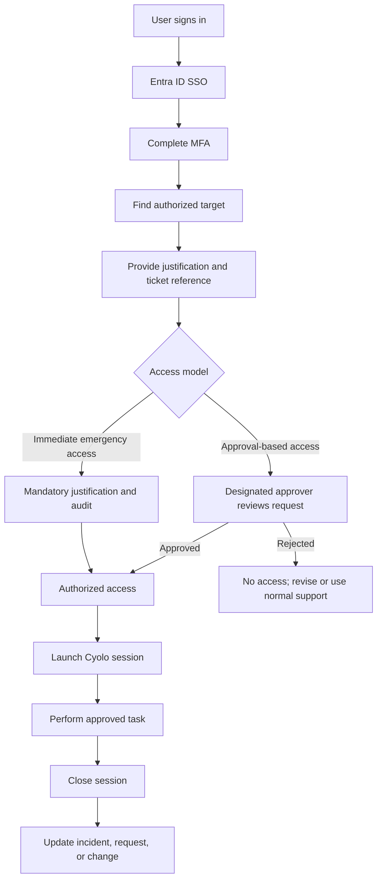

# Breakglass Access Workflows

**Purpose:** Explain the end-user access process for both emergency and approval-based access.  
**Audience:** End users and incident responders.

## User access flow

## Immediate emergency access

Use this model only for an approved emergency and when a delay could create a material outage or security risk.

### Procedure

1. Sign in with SSO and MFA.
2. Select the authorized target.
3. Enter a detailed justification.
4. Provide an active incident, request, or change reference.
5. Confirm the intended task and scope.
6. Obtain immediate authorized access if permitted by policy.
7. Launch the secure session.
8. Perform only the approved emergency task.
9. Close the session and update the ticket.

> [!WARNING]
> Immediate access is not unrestricted access. Justification and audit are mandatory.

## Approval-based access

Use this model when the request must be reviewed before privileged access is granted.

### Procedure

1. Sign in with SSO and MFA.
2. Select the authorized target.
3. Enter the justification and ticket reference.
4. Submit the request to the designated approver.
5. Wait for approval rather than attempting alternative access.
6. After approval, launch the secure session within the approved period.
7. Perform only the approved task.
8. Close the session and update the ticket.

> [!IMPORTANT]
> TBC: Approval and eligibility groups, approver designation, and timed-access duration have not been confirmed.
> Owner: PAM governance and IAM teams

## When to stop

Stop and contact PAM support when:

- The target or environment is incorrect.
- A valid ticket reference cannot be supplied.
- The request is missing required approval.
- The secure session cannot be launched.
- Access is outside the approved purpose or time window.
- A VM may have been restored from a snapshot.

## Source and validation status

**Confirmed:** Two access models, mandatory emergency justification and audit, approval-based access, and secure session launch are required.  
**TBC:** Approval routing, eligible identities, approvers, and access duration.
