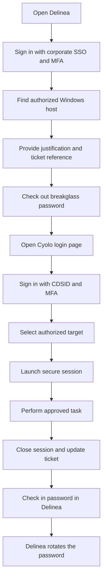

# Breakglass Access Workflows

**Purpose:** Explain the end-user access process for Windows breakglass account password retrieval and secure target connection.  
**Audience:** End users and incident responders.

## Access portals

- [Delinea Secret Server](https://pam.volvocars.net/secretserver/login.aspx?preventautologin=true)
- [Cyolo secure access](https://login.volvocars.cyolo.io/welcome)

## User access flow

## Emergency access

Use emergency access only for an approved emergency when delay could create a material outage or security risk.

### Procedure

1. Open Delinea Secret Server and sign in with SSO and MFA.
2. Select the authorized Windows host.
3. Enter a detailed justification and active ticket reference.
4. Confirm the intended task and scope.
5. Check out the breakglass account password.
6. Open the [Cyolo login page](https://login.volvocars.cyolo.io/welcome) and complete sign-in and MFA.
7. Select the authorized target and launch the secure session.
8. Perform only the approved emergency task.
9. Close the session, update the ticket, and check in the password.

> [!WARNING]
> Immediate access is not unrestricted access. Justification and audit are mandatory.

## Approval-based access

Use this model when a request must be reviewed before privileged access is granted.

### Procedure

1. Open Delinea Secret Server and sign in with SSO and MFA.
2. Select the authorized target.
3. Enter the justification and ticket reference.
4. Submit the request to the designated approver.
5. Wait for approval rather than attempting alternative access.
6. After approval, check out the password and open Cyolo.
7. Sign in to [Cyolo](https://login.volvocars.cyolo.io/welcome), select the target, and launch the session within the approved period.
8. Perform only the approved task.
9. Close the session, update the ticket, and check in the password.

## When to stop

Stop and contact PAM support when:

- The target or environment is incorrect.
- A valid ticket reference cannot be supplied.
- The request is missing required approval.
- The secure session cannot be launched.
- Access is outside the approved purpose or time window.
- A VM may have been restored from a snapshot.
