# Windows Breakglass Access Guide

## Purpose

This guide describes the process for authorized users to retrieve breakglass credentials from **Delinea Secret Server** and establish a secure connection to approved Windows hosts through **Cyolo Secure Access**.

## Audience

Authorized users requiring emergency or administrative breakglass access.

---

# Access Portals

## Delinea Secret Server

| Portal | URL |
|----------|----------|
| Login Page | https://pam.volvocars.net/secretserver/login.aspx?preventautologin=true |
| Home Page | https://pam.volvocars.net/secretserver/ |

## Cyolo Secure Access

| Portal | URL |
|----------|----------|
| Login Page | https://login.volvocars.cyolo.io/welcome |

---

# Prerequisites

Before requesting breakglass access, ensure that:

- The target system is authorized for your request.
- An active Incident, Change Request, or Service Request exists.
- You are eligible for breakglass access.
- You can successfully authenticate using Corporate SSO and MFA.
- The required Windows host is mapped to your authorized access profile.

---

# Process Flow

```mermaid
flowchart LR

    A[User Access Request] --> B[Delinea Secret Server]
    B --> C[Login using $/36 ID or SSO]
    C --> D[Complete MFA]
    D --> E[Locate Authorized Windows Host]
    E --> F[Open Breakglass Account<br/>e.g. volovp27]
    F --> G[Provide Business Justification]
    G --> H[Check Out Password]

    H --> I[Cyolo Secure Access]
    I --> J[Login using CDSID]
    J --> K[Complete SSO and MFA]
    K --> L[View Authorized Hosts]
    L --> M[Launch Secure Session]
    M --> N[Perform Approved Administrative Activity]

    N --> O[Return to Delinea]
    O --> P[Check In Password]
    P --> Q[Password Rotation Triggered]
```



---

# Step 1: Sign in to Delinea Secret Server

1. Open the Delinea login page.
2. Sign in using either:
   - Your Volvo Cars **$/36 ID**, or
   - Corporate **SSO authentication**.
3. Complete the required MFA challenge.
4. Verify that you are signed in with the correct corporate account.

---

# Step 2: Locate the Authorized Breakglass Account

1. Search for the approved Windows host associated with your Incident, Change, or Service Request.
2. Review the list of hosts mapped to your access profile.
3. Locate the required Windows host and corresponding breakglass account.
4. Open the secret entry.

> **Important:** Access is audited. Before checking out a password, a business justification must be provided.

---

# Step 3: Provide Business Justification

Include:

- Incident, Change, or Service Request number.
- Reason for breakglass access.
- Administrative activity being performed.
- Expected duration of access.

### Example

```text
INC123456 – Breakglass access required to perform application recovery
activities on HOSTNAME. Scope limited to service validation and restart
actions. Expected duration: 30 minutes.
```

Do not include passwords, personal data, or other sensitive information in the justification field.

---

# Step 4: Check Out the Password

1. Open the breakglass account secret.
2. Enter the required justification.
3. Select **Check Out Password**.
4. Copy the password securely.

### Password Validity

- Passwords remain valid for **8 hours** after checkout.
- Checkout activities are audited and logged.
- Passwords must not be shared, exported, or stored outside approved systems.

---

# Step 5: Access the Host Through Cyolo

After retrieving the password from Delinea:

1. Open the Cyolo portal.
2. Sign in using your CDSID.
3. Complete SSO and MFA verification.
4. Review the list of authorized hosts available to your account.
5. Select the required target host.
6. Launch the secure session.
7. Authenticate using the breakglass credentials retrieved from Delinea.

> Delinea manages credential governance while Cyolo manages secure session connectivity.

---

# Step 6: Perform Approved Administrative Activities

While connected:

- Use access only for the approved purpose.
- Follow the Incident, Change, or Service Request implementation plan.
- Apply least-privilege principles.
- Limit activities to the approved scope.
- Do not modify unrelated systems or configurations.
- Report unexpected behavior immediately.

---

# Step 7: Check In the Password

After completing the required work:

1. Return to Delinea Secret Server.
2. Locate the checked-out breakglass account.
3. Select **Check In Password**.
4. Confirm the check-in operation.

### Important

- Password checkout remains valid for up to **8 hours**.
- Check in passwords immediately after completing activities.
- Password check-in triggers password rotation based on PAM policy.
- Do not leave passwords checked out longer than necessary.

---

# User Responsibilities

Authorized users must:

- Use the minimum access and duration necessary.
- Follow approved Incident, Change, or Service Request procedures.
- Maintain confidentiality of retrieved credentials.
- Never share, export, or record passwords.
- Close sessions once work is complete.
- Update the associated ticket with actions performed and outcomes.
- Report access or session issues immediately.

---

# Snapshot Recovery Restriction

For virtual machines restored from an older snapshot:

- Do **not** attempt credential recovery or password synchronization.
- Contact the **PAM Support Team** for assistance.

---

# Access Workflow Comparison

| Access Aspect | Emergency Breakglass | Approval-Based Governance |
|--------------|---------------------|--------------------------|
| Approval Requirement | None (Immediate Access) | Designated Approver Required |
| Primary Use Case | Emergency Outages and Production Recovery | Planned Maintenance and Administrative Activities |
| Credential Release | Immediate Password Checkout | Password Released After Approval |
| Access Duration | Standard Checkout Period | Time-Bound Access Window |
| Audit Logging | Mandatory | Mandatory |

---

# User Responsibilities Summary

✅ Provide a valid business justification.

✅ Use access only for approved tasks.

✅ Complete activities within the approved access window.

✅ Check passwords back into Delinea promptly.

✅ Update the related Incident, Change, or Service Request.

✅ Report issues immediately to the PAM Support Team.

---

# Key Reminder

> **Always check the password back into Delinea Secret Server immediately after completing the administrative activity.**
>
> Although passwords remain valid for up to 8 hours, prompt check-in initiates password rotation and helps maintain compliance with Volvo Cars PAM security controls.
