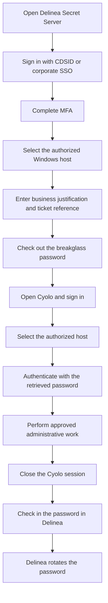

# Windows Breakglass Access Guide

## Purpose

This guide describes how authorized users retrieve the Windows breakglass account password from **Delinea Secret Server** and establish a secure connection to approved Windows hosts through **Cyolo**.

## Audience

Authorized users requiring emergency or administrative breakglass access.

## Access portals

| System | Login page |
|---|---|
| Delinea Secret Server | https://pam.volvocars.net/secretserver/login.aspx?preventautologin=true |
| Cyolo | https://login.volvocars.cyolo.io/welcome |

## Prerequisites

Before requesting breakglass access, ensure that:

- The target system is authorized for your request.
- An active Incident, Change Request, or Service Request exists.
- You are eligible for breakglass access.
- You can successfully authenticate using corporate SSO and MFA.
- The required Windows host is mapped to your authorized access profile.

## Access flow



## Step 1: Sign in to Delinea Secret Server

1. Open the [Delinea Secret Server login page](https://pam.volvocars.net/secretserver/login.aspx?preventautologin=true).
2. Sign in using your corporate identity and SSO.
3. Complete the required MFA challenge.
4. Verify that you are signed in with the correct corporate account.

## Step 2: Locate the authorized host and breakglass account

1. Search for the approved Windows host associated with your Incident, Change, or Service Request.
2. Confirm that the host is mapped to your authorized access profile.
3. Open the breakglass account secret entry.

> Access is audited. A business justification is required before checking out a password.

## Step 3: Provide the business justification

Include:

- Incident, Change, or Service Request number.
- Reason for breakglass access.
- Administrative activity being performed.
- Expected duration of access.

Example:

```text
INC123456 – Breakglass access required to perform application recovery
activities on HOSTNAME. Scope limited to service validation and restart.
Expected duration: 30 minutes.
```

Do not include passwords, personal data, or other sensitive information in the justification field.

## Step 4: Check out the password

1. Open the breakglass account secret.
2. Enter the required justification.
3. Select **Check Out Password**.
4. Copy the password securely for immediate use.

The password remains checked out for up to 8 hours. It must not be shared, exported, or stored outside approved systems.

## Step 5: Access the host through Cyolo

1. Open the [Cyolo login page](https://login.volvocars.cyolo.io/welcome).
2. Sign in using your CDSID.
3. Complete SSO and MFA verification.
4. Select the authorized target host.
5. Launch the secure session.
6. Authenticate using the breakglass account password retrieved from Delinea.

Delinea manages credential governance, while Cyolo provides secure session connectivity.

## Step 6: Perform approved administrative activities

- Use access only for the approved purpose.
- Follow the Incident, Change, or Service Request implementation plan.
- Apply least-privilege principles.
- Limit activity to the approved scope.
- Do not modify unrelated systems or configurations.
- Report unexpected behavior immediately.

## Step 7: Check in the password

After completing the required work:

1. Return to Delinea Secret Server.
2. Locate the checked-out breakglass account.
3. Select **Check In Password**.
4. Confirm the check-in operation.

Check in passwords immediately after completing activities. Checking in the password triggers password rotation according to PAM policy.

## User responsibilities

- Use the minimum access and duration necessary.
- Follow approved Incident, Change, or Service Request procedures.
- Maintain confidentiality of retrieved credentials.
- Never share, export, or record passwords.
- Close sessions when work is complete.
- Update the associated ticket with actions performed and outcomes.
- Report access or session issues immediately.

## VM snapshot recovery restriction

For virtual machines restored from an older snapshot:

- Do not attempt credential recovery or password synchronization.
- Stop repeated sign-in attempts.
- Contact the PAM Support Team.
